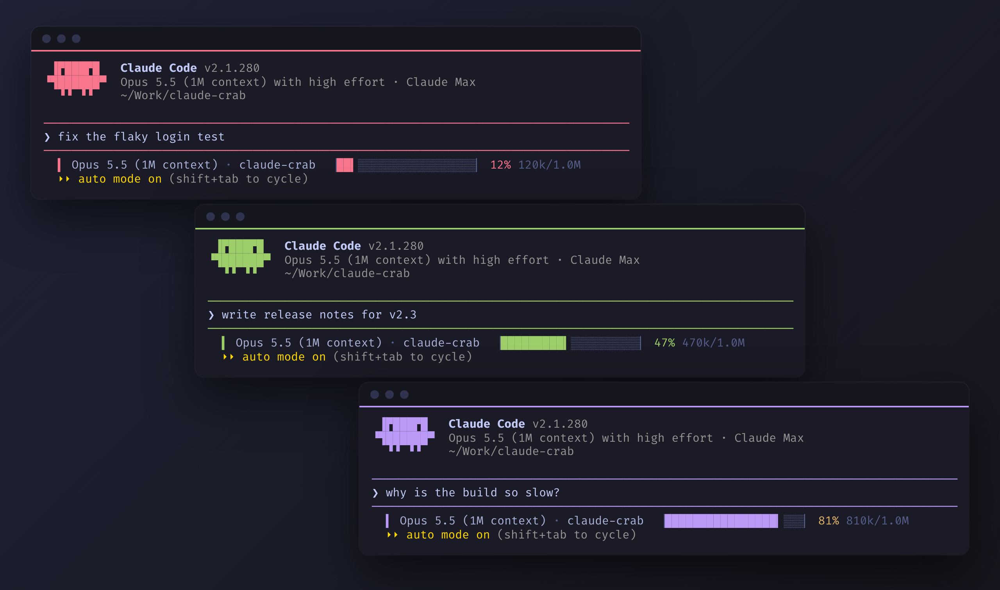

# claude-crab

[](https://github.com/cdaz-dev/claude-crab/actions/workflows/test.yml)

A different crab colour for every Claude Code window.



I usually have three or four Claude Code sessions open at once, and they all look identical, so I kept typing into the wrong one. claude-crab is a small launcher that gives each new window a colour no other open window is using. The crab, the prompt box and the context bar at the bottom all take that colour. When you close a window, its colour goes back in the pool.

It runs on macOS, Linux and Windows.

## Install

macOS and Linux. The status line needs [jq](https://jqlang.org) (`brew install jq` on a Mac).

```sh
git clone https://github.com/cdaz-dev/claude-crab
cd claude-crab
./install.sh --alias
```

Windows, in PowerShell:

```powershell
git clone https://github.com/cdaz-dev/claude-crab
cd claude-crab
powershell -ExecutionPolicy Bypass -File install.ps1 -Alias
```

Open a new terminal and run `claude` like you always do.

The alias flag makes plain `claude` go through claude-crab. Leave it off if you'd rather keep `claude` as it is and type `claude-crab` when you want a colour. Anything you pass, like `claude-crab --resume`, goes straight through to Claude Code.

## How it works

Claude Code reads custom themes from `~/.claude/themes/`, and the crab is drawn with a theme key called `clawd_body`. This repo ships ten themes in Tokyo Night colours: coral, orange, yellow, green, teal, cyan, blue, purple, pink and silver. Each one sets the crab and the prompt border.

A theme is normally a global setting. `claude --settings <file>` loads extra settings for one process only, so claude-crab picks a free colour, writes a tiny settings file for it, and starts Claude Code with that file. Those settings sit on top of your own `settings.json`, and the rest of your config is left alone.

Each window claims its colour with a small file holding its process ID. On every launch claude-crab clears out claims whose process has died, so a window that crashed doesn't keep its colour forever. If all ten are in use, the next window borrows one at random.

## The status line

claude-crab also sets a status line. It shows the model, the folder you're in, and a 20-cell bar of how full the context window is, drawn in the window's crab colour. The percentage turns amber at 70% and red at 90%.

If you already have a status line you like, turn this one off with `CLAUDE_CRAB_STATUSLINE=0` (on Windows, `$env:CLAUDE_CRAB_STATUSLINE = '0'`).

## Options

| Variable | Effect |
| --- | --- |
| `CLAUDE_CRAB_COLOURS` | Theme names to hand out, in order, separated by spaces. Defaults to all ten. |
| `CLAUDE_CRAB_STATUSLINE` | Set to `0` to keep your own status line. |
| `CLAUDE_CONFIG_DIR` | Used if you've moved Claude Code's config folder. |

## Adding a colour

Copy any file in `themes/`, change the hex values, and save it as `~/.claude/themes/crab-<name>.json`. Then list it in `CLAUDE_CRAB_COLOURS`. Themes can override plenty of other keys as well, so you can tint more of the interface if you want.

The crab themes also show up in Claude Code's `/theme` menu. Picking one there saves it as your global theme. claude-crab windows still get their own colour, but plain `claude` sessions will all use that one.

## Omarchy

On [Omarchy](https://omarchy.org), Super+Shift+Ctrl+A opens Claude Code through `omarchy-agent`, which runs plain `claude`. `extras/omarchy/` has a drop-in replacement script and the keybind override that points it at claude-crab.

## Tests

`test/run.sh` and `test/run.ps1` run the launcher against a fake `claude`, so they need no install or login. They check that two windows get different colours, that a crashed window's colour is freed, and that the status line draws the right bar. CI runs them on Ubuntu, macOS with its stock bash 3.2, Windows PowerShell 5.1 and PowerShell 7.

## Uninstall

macOS and Linux: delete `~/.local/bin/claude-crab`, `~/.local/bin/claude-statusline`, the `crab-*.json` files in `~/.claude/themes/`, and the alias line in your `.bashrc` or `.zshrc`.

Windows: delete `%LOCALAPPDATA%\claude-crab`, the `crab-*.json` files in `%USERPROFILE%\.claude\themes\`, the `claude` function in your PowerShell profile, and the `claude-crab\bin` entry in your user PATH.

## License

MIT
